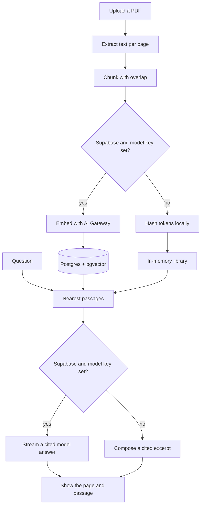

# Folio

Chat with your PDFs. Folio extracts each page, splits it into overlapping passages, embeds those passages, and answers questions with the page they came from.

Without credentials the app runs entirely in **demo mode**: retrieval stays on the server you started, and the answer is composed from the matched passages. Add Supabase and a Vercel AI Gateway key and the same UI stores PDFs in a private bucket, searches with pgvector, and streams a model answer through the AI SDK.



## Architecture

| Piece | Role |
| --- | --- |
| `app/` | Next.js App Router UI and route handlers |
| `lib/chunk.ts` | Page-scoped chunking with overlap |
| `lib/pdf.ts` | Text extraction with `unpdf` |
| `lib/embeddings.ts` | AI Gateway embeddings, or a local hash in demo mode |
| `lib/store/` | Memory store, or Supabase Storage + `match_document_chunks` |
| `app/api/chat` | Retrieval, then AI SDK `streamText` or a local cited answer |
| `supabase/migrations` | pgvector, tables, HNSW index, RLS, private `pdfs` bucket |

The browser never sees the service role key. In live mode it receives only the anon key, and only to upload a large PDF to a signed URL. Documents and embeddings are read and written by the server.

Demo mode keeps the library in the Node process. A restart clears it, and a second serverless instance does not share it. That path is for local runs and for previewing the UI before a database exists.

## Requirements

- Node.js 22 or newer
- A Supabase project only if you leave demo mode
- A Vercel AI Gateway API key, or a Vercel deployment that provides `VERCEL_OIDC_TOKEN`

This repository does not create a Supabase project or a Vercel project for you.

## Local demo, no keys

```bash
npm install
npm run dev
```

Open [http://localhost:3000](http://localhost:3000). Load the sample essay and ask when the reading room opens. The header stays on **Demo · offline retrieval**.

You can also upload a text-based PDF up to 20 MB. Image-only scans have no text layer, so Folio refuses them instead of inventing a transcript.

## Supabase

1. Create a project in the Supabase dashboard.
2. Open the SQL editor and run [`supabase/migrations/20261023235000_init_rag.sql`](supabase/migrations/20261023235000_init_rag.sql).

   Or, with the [Supabase CLI](https://supabase.com/docs/guides/cli) linked to that project:

   ```bash
   supabase db push
   ```

3. Copy the project URL, anon key, and service role key from **Project Settings → API**.

The migration:

- enables `vector` in the `extensions` schema
- creates `documents` and `document_chunks` (`extensions.vector(1536)`)
- adds an HNSW index on cosine distance
- defines `match_document_chunks(query_embedding, match_threshold, match_count, filter_document_ids)`
- enables row level security and revokes `anon` / `authenticated` from both tables
- grants those tables, and execute on the match function, to `service_role` only
- creates a private Storage bucket named `pdfs` (20 MB, PDF only)

There is no public read policy. The Data API cannot list your library with the anon key. The service role bypasses RLS and is used only in route handlers.

Embeddings are `openai/text-embedding-3-small` at 1536 dimensions, which fits a pgvector HNSW index (the index limit is 2000 dimensions). If you change `AI_EMBEDDING_MODEL`, change the `vector(1536)` column to match before you insert rows.

## Environment

Copy the example and fill in real values only on your machine or in the host’s secret store:

```bash
cp .env.example .env.local
```

| Variable | Purpose |
| --- | --- |
| `NEXT_PUBLIC_SUPABASE_URL` | Supabase project URL |
| `NEXT_PUBLIC_SUPABASE_ANON_KEY` | Publishable anon key |
| `SUPABASE_SERVICE_ROLE_KEY` | Server-only key. Never prefix it with `NEXT_PUBLIC_` |
| `AI_GATEWAY_API_KEY` | Model API key for the Vercel AI Gateway |
| `AI_CHAT_MODEL` | Optional. Default `openai/gpt-5.4-mini` |
| `AI_EMBEDDING_MODEL` | Optional. Default `openai/text-embedding-3-small` |
| `FOLIO_DATA_MODE` | `demo`, `live`, or empty |

Empty `FOLIO_DATA_MODE` selects **live** only when the three Supabase variables and a model credential are all present. The model credential is `AI_GATEWAY_API_KEY` or, on Vercel, `VERCEL_OIDC_TOKEN`. Anything missing keeps the app in demo mode.

Do not commit `.env.local`. `.env.example` lists names only.

## Vercel

1. Push this repository and import it as a Next.js project. The framework preset needs no extra build command.
2. Add the variables from `.env.example` in **Project Settings → Environment Variables**. Use Production and Preview. Leave `FOLIO_DATA_MODE` empty so a fully configured project uses pgvector, and an unconfigured preview stays in demo mode.
3. Deploy.

On Vercel you can omit `AI_GATEWAY_API_KEY` when the project’s OIDC token is allowed to call AI Gateway. Supabase keys are still required for live mode.

Function bodies accept about 4.5 MB. Folio sends larger PDFs (up to 20 MB) from the browser to a signed Storage URL, then indexes them from the server. Chat and ingest routes set `maxDuration` so a long PDF can finish on Fluid Compute.

Vercel does not use the Edge runtime here. Streaming runs on the Node.js runtime.

## Scripts

```bash
npm run dev         # local app
npm run lint        # eslint
npm run typecheck   # tsc --noEmit
npm test            # vitest, no network
npm run build       # next build
```

GitHub Actions (`.github/workflows/ci.yml`) runs lint, typecheck, test, and a demo-mode build on every pull request.

## Tests

Unit tests cover chunk boundaries and overlap, filename and PDF checks, demo-mode selection, local embedding rank, citation text for the sample essay, and the presence of the pgvector migration. They do not call Supabase or a model.

## License

[MIT](LICENSE)
